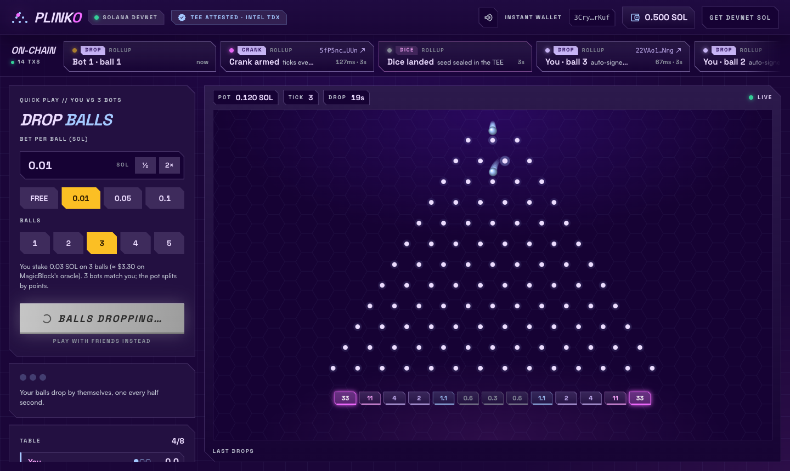
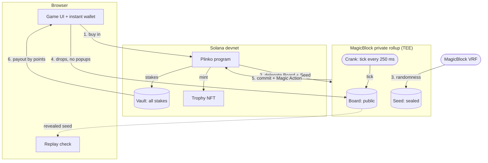
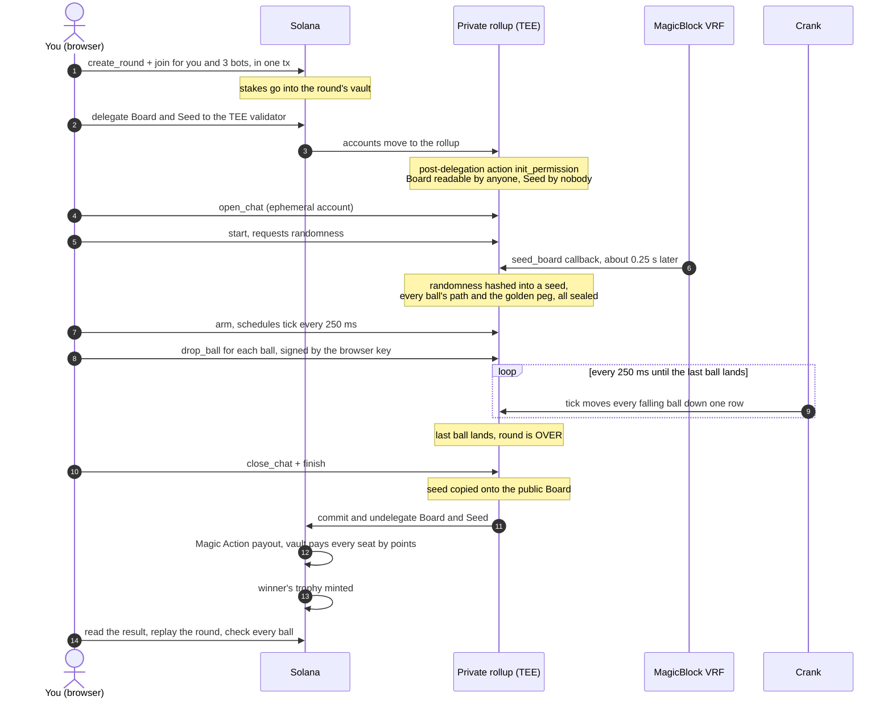
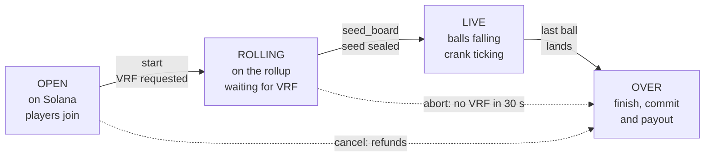
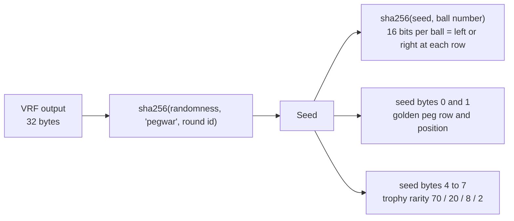
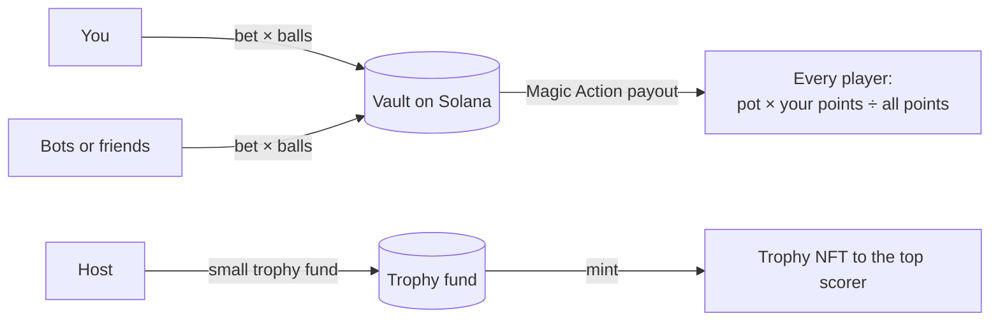

# Plinko

Multiplayer Plinko on Solana, played on MagicBlock's private Ephemeral Rollup.
Pick a bet, pick how many balls, press **Play**. Everything after that signs itself.

**Play it:** https://plinko-sigma-six.vercel.app (Solana devnet; you get free test SOL on your first visit)



| | |
|---|---|
| Program (devnet) | [`Hh2cvEwnqDV995Fkp4yaagjTnrVvmsy7TybiKoJTQNin`](https://explorer.solana.com/address/Hh2cvEwnqDV995Fkp4yaagjTnrVvmsy7TybiKoJTQNin?cluster=devnet) |
| Private rollup | MagicBlock TEE, `https://devnet-tee.magicblock.app` |
| Test USDC mint | `FmZj181DPGvcRejrW9TQVxMxTTMneGjKb2t39cys9Zc4` (spectator bets) |

## How a round plays

1. Choose a bet per ball (free, 0.01, 0.05 or 0.1 SOL) and 1 to 5 balls.
2. Press **Play**. A wallet is created in your browser and topped up with devnet SOL. Three bots take seats with the same stake.
3. Your balls drop on their own, one every half second, through 12 rows of pegs.
4. The outer bins score the most (33 points) and the centre bins the least (0.3). One peg is secretly golden: the first ball to touch it scores double.
5. When every ball has landed, the pot is split by points and paid out automatically. The top scorer also gets a trophy NFT.

A quick-play round takes about 30 seconds from the click to the payout. To play against real people instead, **Play with friends** opens a lobby with an invite link, a table chat and betting for spectators.

## Why a private rollup

A Plinko game on-chain has two problems:

- **Speed.** A ball crosses 12 rows in 3 seconds. Solana blocks are too slow and too costly for a board that moves every 250 ms, and nobody wants a wallet popup per ball.
- **Secrecy.** If the random path of every ball sits in a normal account, anyone can read it and know the result before the ball falls. And if the result is worked out in advance, someone can simulate a transaction to see it early.

MagicBlock's private Ephemeral Rollup solves both. The round moves onto a rollup that runs inside an Intel TDX enclave (TEE): transactions there settle in milliseconds and cost nothing, and an account can be locked so that no one, not even the rollup operator, can read it. When the round is over, the result is committed back to Solana and paid out there.

## Architecture



The money never moves to the rollup. Stakes sit in a vault on Solana the whole time; only the Board and the Seed are delegated. The payout runs on Solana once the result has been committed.

## A round, transaction by transaction



Every one of these shows up in the strip at the top of the game, with an Explorer link:

| Card | Where | What it is | MagicBlock part |
|---|---|---|---|
| CREATE | Solana | Table opened, you and the bots seated, stakes in the vault | |
| DELEGATE | Solana → rollup | Board and Seed handed to the TEE validator | Delegation program |
| SEAL | Rollup | Board made public, Seed locked from its first slot | Permissions, post-delegation action |
| ROUTER | Rollup | Which rollup holds the board | Magic Router |
| VRF / DICE | Rollup | Randomness requested, then delivered and sealed | VRF |
| CRANK | Rollup | Board ticks every 250 ms on its own | Scheduled tasks |
| DROP | Rollup | One ball released, about 70 to 130 ms to confirm | Ephemeral Rollup |
| COMMIT | Rollup → Solana | Seed revealed, Board and Seed returned to Solana | Commit + undelegate |
| PAYOUT | Solana | Vault pays every player (sent by MagicBlock's validator) | Magic Action |
| TROPHY | Solana | Metaplex Core NFT for the top scorer | |
| SWEEP | Solana | Quick play only: the bots' SOL comes back to you | |

Rollup transactions open in Solana Explorer pointed at the TEE's RPC. Explorer asks once before connecting to it, and shows the transaction's status and time; the rollup keeps the details private.

## Round states



## Who can see what

| | Board (balls, scores) | Seed (every ball's path, golden peg) |
|---|---|---|
| Before the round, on Solana | Public | Empty |
| During the round, on the rollup | Anyone with a rollup token | **Nobody.** Its permission has an empty member list |
| After the round, back on Solana | Public, with the seed copied onto it | Public |

How the seal holds up:

- **Sealed on arrival.** The permission is created by a post-delegation action, inside the same step that moves the Seed onto the rollup. There is no moment where the Seed is on the rollup but readable.
- **Every reader is known.** The rollup hands out access tokens signed by each reader's wallet and checks every read against the account's permission. Without a token, transaction lookups come back with their contents removed.
- **No peeking by simulation.** The board is only ever moved forward to the current slot. A simulated transaction sees exactly what a real one would: where balls are now, not where they will be.
- **One row at a time.** A ball's next bounce is applied only when it reaches that row, so the path leaks out a step at a time as the ball falls, the same way you see it on screen.
- **Checked by the player.** After the round, the browser replays every ball from the revealed seed with a TypeScript copy of the on-chain rules and flags any ball that landed somewhere else.
- **Checked enclave.** The badge in the top bar verifies the rollup's Intel TDX attestation before you play.

## Randomness



The VRF request is made by `start` and answered by MagicBlock's oracle calling `seed_board` on the rollup, so no player, host or game server picks the randomness, and it goes straight into the sealed Seed. The same seed decides the trophy's rarity (Common, Rare, Epic or Legendary).

## Money



- The pot is split by points, so everyone who scores gets something back. If nobody scored (the dice never came), the pot is split evenly.
- The last player paid also takes the rounding dust, so the vault always ends at exactly zero.
- The payout is a Magic Action attached to the commit, so it runs on Solana the moment the round lands there and needs no one's signature. If that path ever fails, a fallback commit lets anyone trigger the same payout with `claim`.
- In quick play the bots are funded from your wallet and swept back to you after the round, so you only spend network fees.
- In friends mode, spectators can back a player with test USDC. The bets move onto the rollup as ephemeral SPL tokens, are placed with no fees, and are split among the backers of the winner.

## MagicBlock features used

| Feature | How Plinko uses it |
|---|---|
| Private Ephemeral Rollup (TEE) | Runs the whole round: drops in milliseconds, no fees, no popups |
| Delegation + post-delegation actions | Moves Board and Seed to the TEE validator and seals the Seed on arrival |
| Permissions (access control) | Board public; Seed readable by nobody until the end |
| VRF | Fair randomness for every ball path, the golden peg and the trophy rarity |
| Scheduled tasks (crank) | The rollup itself ticks the board every 250 ms; no client has to stay online |
| Commit + undelegate | Returns the finished Board and the revealed Seed to Solana |
| Magic Actions | Runs `payout` on Solana straight after the commit |
| Ephemeral accounts | Table chat that lives only on the rollup and is closed before commit |
| Session keys | With Phantom you approve once; a browser key then signs every move |
| Ephemeral SPL tokens | Spectator bets in test USDC, deposited to and withdrawn from the rollup |
| Price oracle | SOL/USD feed read on the rollup to show your stake in dollars (the program can also lock a ball's price in dollars) |
| Magic Router | Finds which rollup holds the board |
| TEE attestation | Verifies the enclave in the browser before you play |

### Addresses

| | Address |
|---|---|
| Plinko program | `Hh2cvEwnqDV995Fkp4yaagjTnrVvmsy7TybiKoJTQNin` |
| TEE validator | `MTEWGuqxUpYZGFJQcp8tLN7x5v9BSeoFHYWQQ3n3xzo` |
| Delegation program | `DELeGGvXpWV2fqJUhqcF5ZSYMS4JTLjteaAMARRSaeSh` |
| Permission program | `ACLseoPoyC3cBqoUtkbjZ4aDrkurZW86v19pXz2XQnp1` |
| Magic program | `Magic11111111111111111111111111111111111111` |
| VRF oracle queue | `5hBR571xnXppuCPveTrctfTU7tJLSN94nq7kv7FRK5Tc` |
| SOL/USD price feed | `ENYwebBThHzmzwPLAQvCucUTsjyfBSZdD9ViXksS4jPu` |
| Session keys program | `KeyspM2ssCJbqUhQ4k7sveSiY4WjnYsrXkC8oDbwde5` |

## Repo layout

```
programs/pegwar/          Anchor program (crate name `pegwar`, the game's working title)
  src/lib.rs              buy-in, delegation, VRF, drops, crank, chat, bets, finish + payout
  src/sim.rs              the referee: deterministic board simulation, with unit tests
app/                      web app (Vite + TypeScript)
  src/main.ts             screens and the one-click round
  src/chain.ts            every Solana and MagicBlock call
  src/sim.ts              TypeScript copy of sim.rs, used for the replay check
  src/board.ts            canvas board, sound and effects
  server/faucet.ts        devnet SOL for new players
  api/fund.ts             the faucet as a Vercel function
  scripts/e2e.ts          plays one full round against devnet from the command line
```

Devnet only: the SOL and test USDC here have no value.
